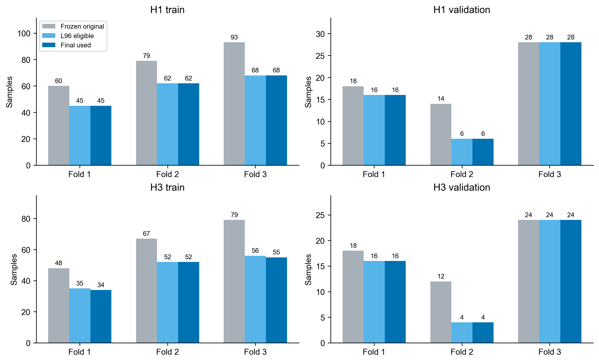

# 样本与时间资格

仅复用上一阶段保存的L96五项特征和实际测量身份，不要求L192合格；L192、future lead、未来工况及未来时间均不进入模型矩阵。资格为至少5个观测、实际跨度至少67.2h、所有观测测量结束时刻不晚于预测起点。真实测量时间来自已冻结的Raw重建缓存，未重新解析Raw。

R=V_P1S/0.71383023635。历史保持率来自因果合格的原始P1S；参考电压已在首个合法预测起点前确定。旧缓存的conservative_available_end_h是完整dwell状态结束时刻，比实际P1S结束约0.01–0.02h晚；本轮沿用冻结authority的实际P1S测量结束时刻，没有重新移动预测起点。没有实际发布延迟证据时，不额外捏造该延迟。

H1目标raw ID=origin+1，H3=origin+3；小型Development周期目录核验包含起点、目标和H3中间周期均完整。身份和标签与原authority逐项核对；无Test或2000/2300h后期目标读取，目录最大结束时间1811.41h。

| fold | train_start_h | train_end_validation_start_h | validation_end_h |
| --- | --- | --- | --- |
| fold_1 | 72.788690 | 946.393214 | 1164.794345 |
| fold_2 | 72.788690 | 1164.794345 | 1383.195476 |
| fold_3 | 72.788690 | 1383.195476 | 1819.997738 |

标签整个测量区间必须落入对应Train或Validation范围。模型参数还要求所有Train标签在最早实际使用Validation起点前结束。内部选择仍为Train末尾ceil(15%N)，inner-fit标签在首个inner-selection起点前结束；标准化各自只用合法训练部分。

| horizon | fold | role | authority_n | L96_eligible_n | used_n | outer_purged_n |
| --- | --- | --- | --- | --- | --- | --- |
| H1 | fold_1 | train | 60 | 45 | 45 | 0 |
| H1 | fold_1 | validation | 18 | 16 | 16 | 0 |
| H1 | fold_2 | train | 79 | 62 | 62 | 0 |
| H1 | fold_2 | validation | 14 | 6 | 6 | 0 |
| H1 | fold_3 | train | 93 | 68 | 68 | 0 |
| H1 | fold_3 | validation | 28 | 28 | 28 | 0 |
| H3 | fold_1 | train | 48 | 35 | 34 | 1 |
| H3 | fold_1 | validation | 18 | 16 | 16 | 0 |
| H3 | fold_2 | train | 67 | 52 | 52 | 0 |
| H3 | fold_2 | validation | 12 | 4 | 4 | 0 |
| H3 | fold_3 | train | 79 | 56 | 55 | 1 |
| H3 | fold_3 | validation | 24 | 24 | 24 | 0 |

H3第一、三折各剔除一条参数尚不可获得的Train行：

| horizon | fold | sample_index | origin_raw_cycle_id | target_raw_cycle_id | target_p1s_measurement_end_ophrs2_h | exclusion_reason |
| --- | --- | --- | --- | --- | --- | --- |
| H3 | fold_1 | 47 | 78 | 81 | 943.015990 | TRAIN_LABEL_NOT_AVAILABLE_AT_FIRST_VALIDATION_ORIGIN |
| H3 | fold_3 | 78 | 114 | 117 | 1380.650000 | TRAIN_LABEL_NOT_AVAILABLE_AT_FIRST_VALIDATION_ORIGIN |

| horizon | fold | train_max_label_end_h | first_validation_origin_h | inner_max_label_end_h | first_inner_selection_origin_h |
| --- | --- | --- | --- | --- | --- |
| H1 | fold_1 | 943.015990 | 971.586980 | 828.684880 | 828.684880 |
| H1 | fold_2 | 1124.330000 | 1323.500000 | 1029.090000 | 1029.090000 |
| H1 | fold_3 | 1380.650000 | 1390.170000 | 1076.710000 | 1076.710000 |
| H3 | fold_1 | 933.131840 | 933.131840 | 790.381650 | 790.381650 |
| H3 | fold_2 | 1124.330000 | 1323.500000 | 1029.090000 | 1029.090000 |
| H3 | fold_3 | 1371.120000 | 1371.120000 | 1048.140000 | 1048.140000 |

全部原始authority共540行，最终合法角色行410条、外部排除130条；这包含expanding folds重复出现的训练行，不是410个独立新周期。六条inner-fit时间剔除另存INNER_SPLITS.csv，其标签可在最终outer模型使用，因此不会从最终Train重复删除。

全部剔除原因：

| horizon | fold | role | exclusion_stage | exclusion_reason | n |
| --- | --- | --- | --- | --- | --- |
| H1 | fold_1 | train | history_qualification | COUNT_BELOW_MINIMUM | 7 |
| H1 | fold_1 | train | history_qualification | SPAN_BELOW_70_PERCENT | 8 |
| H1 | fold_1 | validation | history_qualification | SPAN_BELOW_70_PERCENT | 2 |
| H1 | fold_2 | train | history_qualification | COUNT_BELOW_MINIMUM | 7 |
| H1 | fold_2 | train | history_qualification | SPAN_BELOW_70_PERCENT | 10 |
| H1 | fold_2 | validation | history_qualification | COUNT_BELOW_MINIMUM | 4 |
| H1 | fold_2 | validation | history_qualification | SPAN_BELOW_70_PERCENT | 4 |
| H1 | fold_3 | train | history_qualification | COUNT_BELOW_MINIMUM | 11 |
| H1 | fold_3 | train | history_qualification | SPAN_BELOW_70_PERCENT | 14 |
| H3 | fold_1 | train | history_qualification | COUNT_BELOW_MINIMUM | 5 |
| H3 | fold_1 | train | history_qualification | SPAN_BELOW_70_PERCENT | 8 |
| H3 | fold_1 | train | outer_parameter_time | TRAIN_LABEL_NOT_AVAILABLE_AT_FIRST_VALIDATION_ORIGIN | 1 |
| H3 | fold_1 | validation | history_qualification | SPAN_BELOW_70_PERCENT | 2 |
| H3 | fold_2 | train | history_qualification | COUNT_BELOW_MINIMUM | 5 |
| H3 | fold_2 | train | history_qualification | SPAN_BELOW_70_PERCENT | 10 |
| H3 | fold_2 | validation | history_qualification | COUNT_BELOW_MINIMUM | 4 |
| H3 | fold_2 | validation | history_qualification | SPAN_BELOW_70_PERCENT | 4 |
| H3 | fold_3 | train | history_qualification | COUNT_BELOW_MINIMUM | 9 |
| H3 | fold_3 | train | history_qualification | SPAN_BELOW_70_PERCENT | 14 |
| H3 | fold_3 | train | outer_parameter_time | TRAIN_LABEL_NOT_AVAILABLE_AT_FIRST_VALIDATION_ORIGIN | 1 |

inputs/L96_REUSED_FEATURES.csv保存全部540行，仅保留L96和身份字段；L96_TIME_IDENTITIES.json保存每条历史周期名单。LEGAL_SAMPLES.csv、EXCLUDED_SAMPLES.csv、INNER_SPLITS.csv保留具体样本与原因，SAMPLE_COUNTS.csv保存计数。

