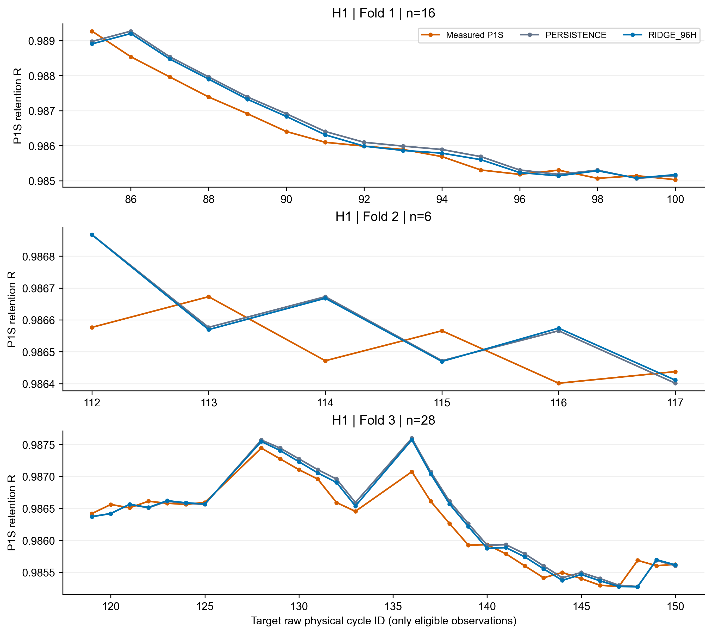
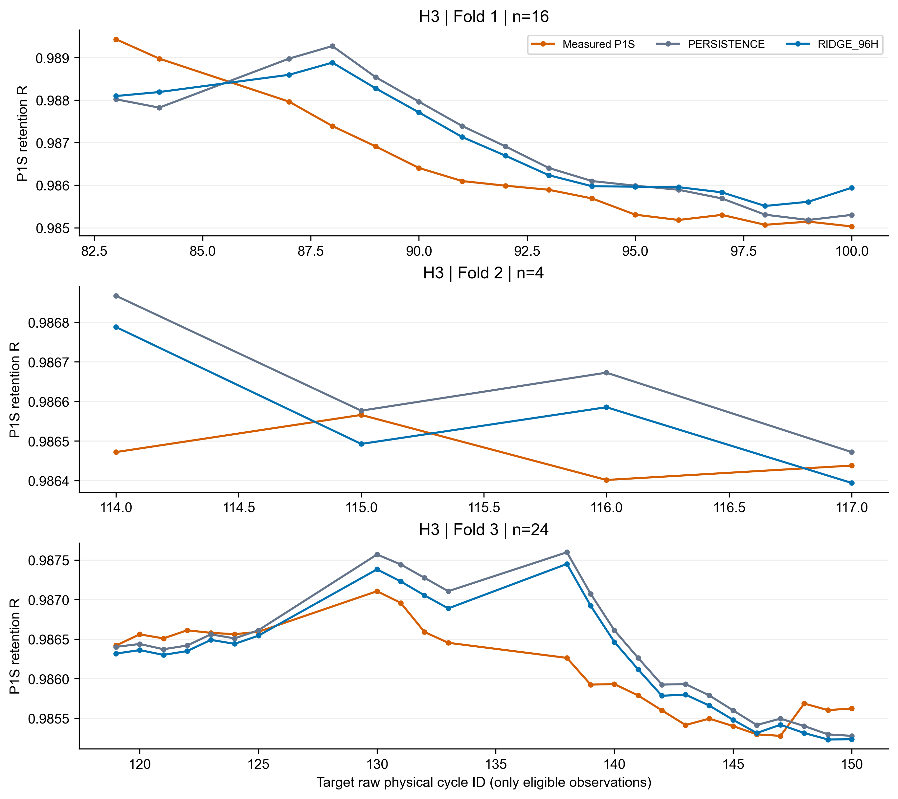

# 96h模型三折结果

五项固定输入为最新保持率、96h均值、总体标准差(ddof=0)、相对实际测量结束小时的线性斜率、最新值减历史中位数。以这些历史输入预测DeltaR，再加回origin R；目标不缩放。Ridge alpha网格固定0.0001/0.01/1/100，按内部MAE择优，相等选较小alpha。每折重新拟合，未沿用旧系数。

| horizon | fold | alpha | train_n | inner_fit_n | inner_selection_n | inner_purged_n |
| --- | --- | --- | --- | --- | --- | --- |
| H1 | fold_1 | 100.000000 | 45 | 38 | 7 | 0 |
| H1 | fold_2 | 100.000000 | 62 | 52 | 10 | 0 |
| H1 | fold_3 | 100.000000 | 68 | 57 | 11 | 0 |
| H3 | fold_1 | 0.000100 | 34 | 26 | 6 | 2 |
| H3 | fold_2 | 100.000000 | 52 | 42 | 8 | 2 |
| H3 | fold_3 | 100.000000 | 55 | 44 | 9 | 2 |

| horizon | fold | model | n | MAE_R | RMSE_R | MAE_mV_equivalent | RMSE_mV_equivalent | P95_abs_error_mV_equivalent | max_abs_error_mV_equivalent |
| --- | --- | --- | --- | --- | --- | --- | --- | --- | --- |
| H1 | fold_1 | PERSISTENCE | 16 | 0.000308 | 0.000368 | 0.219620 | 0.263019 | 0.438363 | 0.521973 |
| H1 | fold_1 | RIDGE_96H | 16 | 0.000260 | 0.000325 | 0.185905 | 0.232160 | 0.392029 | 0.472957 |
| H1 | fold_2 | PERSISTENCE | 6 | 0.000147 | 0.000169 | 0.105024 | 0.120636 | 0.191481 | 0.207500 |
| H1 | fold_2 | RIDGE_96H | 6 | 0.000148 | 0.000170 | 0.105331 | 0.121282 | 0.190440 | 0.207305 |
| H1 | fold_3 | PERSISTENCE | 28 | 0.000162 | 0.000216 | 0.115866 | 0.153852 | 0.316286 | 0.373924 |
| H1 | fold_3 | RIDGE_96H | 28 | 0.000143 | 0.000195 | 0.102398 | 0.139038 | 0.301756 | 0.356298 |
| H3 | fold_1 | PERSISTENCE | 16 | 0.000881 | 0.001035 | 0.629153 | 0.739063 | 1.206127 | 1.341203 |
| H3 | fold_1 | RIDGE_96H | 16 | 0.000816 | 0.000898 | 0.582515 | 0.640873 | 0.996126 | 1.063674 |
| H3 | fold_2 | PERSISTENCE | 4 | 0.000178 | 0.000240 | 0.127019 | 0.171666 | 0.268993 | 0.282267 |
| H3 | fold_2 | RIDGE_96H | 4 | 0.000154 | 0.000188 | 0.110230 | 0.134136 | 0.211628 | 0.225789 |
| H3 | fold_3 | PERSISTENCE | 24 | 0.000379 | 0.000502 | 0.270291 | 0.358611 | 0.769764 | 0.952344 |
| H3 | fold_3 | RIDGE_96H | 24 | 0.000318 | 0.000418 | 0.226755 | 0.298517 | 0.662009 | 0.847063 |

| horizon | Persistence_MAE_mV | Ridge96_MAE_mV | improvement_percent | fold_wins |
| --- | --- | --- | --- | --- |
| H1 | 0.146837 | 0.131211 | 10.641466 | 2 |
| H3 | 0.342154 | 0.306500 | 10.420448 | 3 |

TRAINED_PARAMETERS.json保存六套实际训练样本ID、内部样本ID、alpha网格分数、标准化均值和尺度、五个系数与截距。INNER_ALPHA_SCORES.csv为24个实际内部拟合分数，不用外部Validation选alpha。

所有数值均为P1S保持率误差或其mV-equivalent换算，不是动态电压预测RMSE，也不是已验证的真实SOH误差。三折均值为各折等权平均，不按样本数加权。

曲线只连接实际合格观测以便观看，不插值填补SOH标签；横轴使用物理周期raw ID，不把稀疏观测当作连续时间标签。
