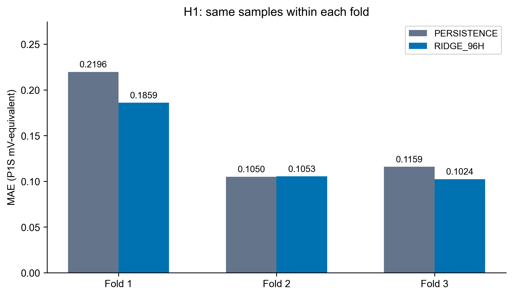
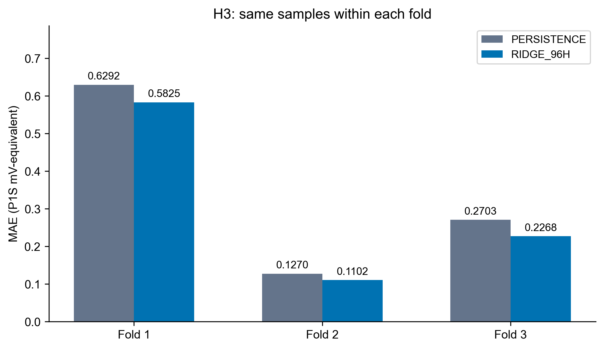

# 同样本正式比较

每折Persistence和96h Ridge使用完全相同的合法验证键；主指标为三折MAE等权平均。

| horizon | fold | n | Persistence_MAE_mV_equivalent | Ridge_MAE_mV_equivalent | improvement_MAE_mV_equivalent | Persistence_RMSE_mV_equivalent | Ridge_RMSE_mV_equivalent | improvement_RMSE_mV_equivalent | Persistence_P95_abs_error_mV_equivalent | Ridge_P95_abs_error_mV_equivalent | improvement_P95_abs_error_mV_equivalent | Persistence_max_abs_error_mV_equivalent | Ridge_max_abs_error_mV_equivalent | improvement_max_abs_error_mV_equivalent |
| --- | --- | --- | --- | --- | --- | --- | --- | --- | --- | --- | --- | --- | --- | --- |
| H1 | fold_1 | 16 | 0.219620 | 0.185905 | 0.153518 | 0.263019 | 0.232160 | 0.117327 | 0.438363 | 0.392029 | 0.105698 | 0.521973 | 0.472957 | 0.093905 |
| H1 | fold_2 | 6 | 0.105024 | 0.105331 | -0.002927 | 0.120636 | 0.121282 | -0.005349 | 0.191481 | 0.190440 | 0.005436 | 0.207500 | 0.207305 | 0.000940 |
| H1 | fold_3 | 28 | 0.115866 | 0.102398 | 0.116242 | 0.153852 | 0.139038 | 0.096285 | 0.316286 | 0.301756 | 0.045941 | 0.373924 | 0.356298 | 0.047138 |
| H3 | fold_1 | 16 | 0.629153 | 0.582515 | 0.074127 | 0.739063 | 0.640873 | 0.132858 | 1.206127 | 0.996126 | 0.174112 | 1.341203 | 1.063674 | 0.206925 |
| H3 | fold_2 | 4 | 0.127019 | 0.110230 | 0.132172 | 0.171666 | 0.134136 | 0.218625 | 0.268993 | 0.211628 | 0.213260 | 0.282267 | 0.225789 | 0.200085 |
| H3 | fold_3 | 24 | 0.270291 | 0.226755 | 0.161071 | 0.358611 | 0.298517 | 0.167575 | 0.769764 | 0.662009 | 0.139985 | 0.952344 | 0.847063 | 0.110549 |

H1第1折改善15.35%，第2折退步0.29%，第3折改善11.62%；平均改善10.64%，两折优于Persistence。第2折RMSE增加约0.000645 mV-equivalent(0.53%)，MAE增加约0.000307(0.29%)，确实存在轻微局部退步，应保留展示。三折P95/最大误差分别均下降，未见明显大误差恶化。6个样本不足以支持第二折稳定优势。

H3三折MAE分别改善7.41%、13.22%、16.11%，三折平均改善10.42%；RMSE、P95与最大误差三折均降低，但第二折仅4个样本，H3为辅助证据。

第二折的实际逐点误差：

| horizon | origin_raw_cycle_id | target_raw_cycle_id | true_R_P1S_causal | predicted_R_P1S_causal | absolute_error_mV_equivalent |
| --- | --- | --- | --- | --- | --- |
| H1 | 111 | 112 | 0.986577 | 0.986867 | 0.207305 |
| H1 | 112 | 113 | 0.986673 | 0.986569 | 0.073701 |
| H1 | 113 | 114 | 0.986472 | 0.986668 | 0.139844 |
| H1 | 114 | 115 | 0.986566 | 0.986469 | 0.068767 |
| H1 | 115 | 116 | 0.986401 | 0.986574 | 0.123283 |
| H1 | 116 | 117 | 0.986438 | 0.986411 | 0.019086 |
| H3 | 111 | 114 | 0.986472 | 0.986788 | 0.225789 |
| H3 | 112 | 115 | 0.986566 | 0.986492 | 0.052387 |
| H3 | 113 | 116 | 0.986401 | 0.986585 | 0.131379 |
| H3 | 114 | 117 | 0.986438 | 0.986394 | 0.031366 |

冻结程序额外采用了“每折RMSE、P95、最大误差均不得上升”的充分条件，比原指令的“无明显恶化”更严。H1仅因第二折RMSE微升0.53%得到自动MIXED；该额外条件不覆盖用户原判据。原判据下H1为SUPPORTED，原始DECISIONS.json和冻结协议均保留，FINAL_RESEARCH_JUDGMENT.json记录解释。没有修改5%门槛、参数、预测或重复训练。

