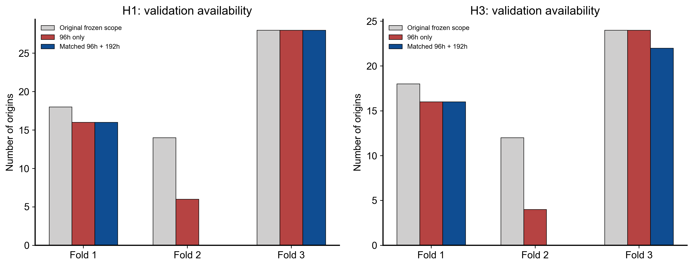

# 实验定义和冻结来源

R=V_P1S/0.71383023635，参考在171.82091h后可得，前10complete只暖启动，131因果事件。H1=origin raw cycle+1；H3=+3且全部中间raw cycle完整。来源H1/H3冻结样本292/248行、原CTAE/PAA测量、H1已保存实际middle_50时间重建、PHI周期身份及Development raw-cycle目录。没有重解析Raw、mixed N1读取或晚期目标。

原始三个fold角色不改：标签测量start≥角色下界、end<角色上界。来源SHA和执行代码SHA在configs/FROZEN_LONG_HISTORY_PROTOCOL.json，原始authority在inputs；保留同一origin在多个expanding folds的身份，不冒充独立电堆。

输入窗口终点用实际P1S测量结束小时，观测必须已结束且参考可得；origin本人包含。原CTAE保守结束记录也留存，不用名义周期9.5h取代真实间隔。年龄只用于构造历史窗口和斜率、不得直接作为模型特征；target小时仅定义标签/隔离/绘图评价。

两种长度共同输入资格决定同一个Train/Validation集合，依据数量/跨度，不看目标误差。额外执行标签可获得性purge：最终Train标签必须在首个共同Validation origin前结束；inner fit标签必须在inner选择首origin前结束。两模型同时应用，原样本身份保留、剔除原因另存。原H3仅目标区间划分的边界部分会产生模型参数晚于早期origin的风险，本轮关闭该风险，不改变旧历史结果。

完整数量变化见sample_counts.csv；原历史Persistence全验证scope逐点身份/单位核验通过，新的排名仅用共同scope，不与历史完整scope的均值直接相减。

## 原始到实际使用样本的变化

|任务|fold|Train 原始→使用|Validation 原始→使用|
|---|---|---|---|
|H1|fold_1|60→38|18→16|
|H1|fold_2|79→55|14→0|
|H1|fold_3|93→55|28→28|
|H3|fold_1|48→29|18→16|
|H3|fold_2|67→47|12→0|
|H3|fold_3|79→47|24→22|

H3 Fold1额外剔除1个尚晚于首验证起点的训练标签；其他outer purge为0。inner H3每fold剔除2个跨首inner origin的训练标签；固定最后15%选择段不动、两种长度一致。H1 inner purge为0。
