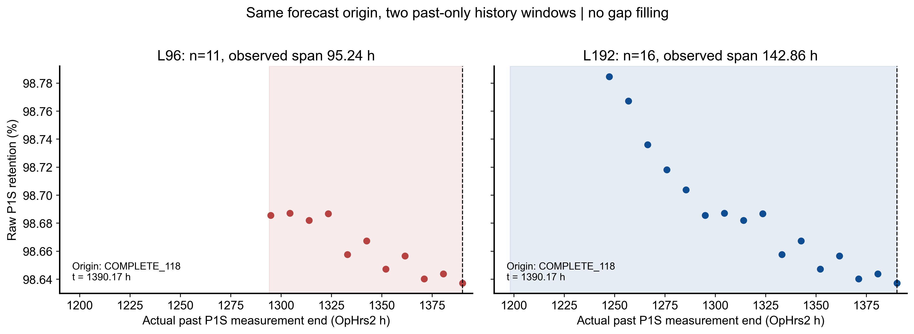

# 共同五特征与过去窗口

特征顺序固定：origin最新R、窗口mean R、population std R(ddof=0)、R对实际测量小时OLS斜率、origin R−窗口median R。除斜率单位h^-1外，均无量纲保持率。标准化仅inner-fit选alpha或final outer-Train refit，不用Validation。目标DeltaR保持原无量纲，不另标准化。

L96至少5观测和67.2h跨度；L192至少10观测和134.4h跨度。最早到最新真实观测的跨度计算，不能以cycle数量×9.5h替代。窗口边界[t−L,t]，保留全部合法观测，不按support删点，不插值/填gap，不加第三长度。

Ridge固定alpha=0.0001/0.01/1/100；后15%按ceil切出inner选择段，早85%在标签时间purge后fit scaler及模型。以inner MAE最小选alpha，同分选小alpha；随后完整合法outer-Train重新拟合。最终参数、尺度与inner评分均保存，五列之外没有future lead/target/工况/B2/平滑特征。

图中只有真实历史P1S测量点与窗口范围，未虚构连续SOH轨迹。模型M0/M96/M192未来R分别是origin R、origin R+96h Ridge DeltaR、origin R+192h Ridge DeltaR；H1/H3独立拟合，不递推H1生成H3。
