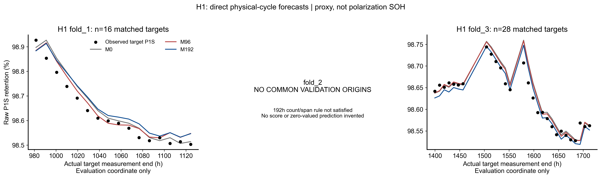

# H1实际预测结果

|fold|model|status|n_train|n_validation|MAE_R|RMSE_R|MAE_mV_equivalent|RMSE_mV_equivalent|P95_abs_error_mV_equivalent|max_abs_error_mV_equivalent|
|---|---|---|---|---|---|---|---|---|---|---|
|fold_1|M0|COMPLETED|38|16|0.000308|0.000368|0.219620|0.263019|0.438363|0.521973|
|fold_1|M96|COMPLETED|38|16|0.000279|0.000328|0.198933|0.234422|0.351808|0.445153|
|fold_1|M192|COMPLETED|38|16|0.000395|0.000422|0.281635|0.301152|0.406261|0.426503|
|fold_2|M0|NOT_EVALUABLE_NO_COMMON_VALIDATION|55|0|不可评价|不可评价|不可评价|不可评价|不可评价|不可评价|
|fold_2|M96|NOT_EVALUABLE_NO_COMMON_VALIDATION|55|0|不可评价|不可评价|不可评价|不可评价|不可评价|不可评价|
|fold_2|M192|NOT_EVALUABLE_NO_COMMON_VALIDATION|55|0|不可评价|不可评价|不可评价|不可评价|不可评价|不可评价|
|fold_3|M0|COMPLETED|55|28|0.000162|0.000216|0.115866|0.153852|0.316286|0.373924|
|fold_3|M96|COMPLETED|55|28|0.000148|0.000200|0.105807|0.142932|0.305662|0.362426|
|fold_3|M192|COMPLETED|55|28|0.000133|0.000182|0.094593|0.130050|0.273306|0.353551|

|model|available_folds|formal_three_fold_equal_MAE_mV|descriptive_available_fold_equal_MAE_mV|pooled_n_validation|pooled_P95_abs_error_mV|pooled_max_abs_error_mV|fold3_MAE_mV|
|---|---|---|---|---|---|---|---|
|M0|2|不可评价|0.167743|44|0.403515|0.521973|0.115866|
|M96|2|不可评价|0.152370|44|0.320223|0.445153|0.105807|
|M192|2|不可评价|0.188114|44|0.393527|0.426503|0.094593|

三fold正式平均无法计算；有数据两fold平均及pooled仅诊断，分母明确。空fold每方法没有任何预测行，未补造，不记零误差。每fold预测CSV位于outputs/predictions，合并predictions.csv。n_train是同样本与参数时间purge后的数量；全部删除记录保留。

图横轴未来测量时刻仅评价显示，绝不作为输入。黑点是实际离散P1S观测，不是极化SOH；H1/H3不称固定10/30h。实际lead统计见ACTUAL_LEAD_SUMMARY.csv，含时间单位/分布，仅描述。
