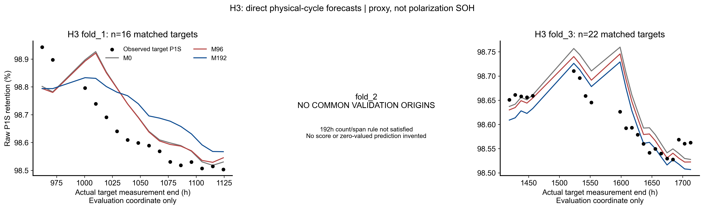

# H3实际预测结果

|fold|model|status|n_train|n_validation|MAE_R|RMSE_R|MAE_mV_equivalent|RMSE_mV_equivalent|P95_abs_error_mV_equivalent|max_abs_error_mV_equivalent|
|---|---|---|---|---|---|---|---|---|---|---|
|fold_1|M0|COMPLETED|29|16|0.000881|0.001035|0.629153|0.739063|1.206127|1.341203|
|fold_1|M96|COMPLETED|29|16|0.000889|0.001030|0.634704|0.735005|1.179604|1.301697|
|fold_1|M192|COMPLETED|29|16|0.001091|0.001147|0.779061|0.818500|1.080666|1.132968|
|fold_2|M0|NOT_EVALUABLE_NO_COMMON_VALIDATION|47|0|不可评价|不可评价|不可评价|不可评价|不可评价|不可评价|
|fold_2|M96|NOT_EVALUABLE_NO_COMMON_VALIDATION|47|0|不可评价|不可评价|不可评价|不可评价|不可评价|不可评价|
|fold_2|M192|NOT_EVALUABLE_NO_COMMON_VALIDATION|47|0|不可评价|不可评价|不可评价|不可评价|不可评价|不可评价|
|fold_3|M0|COMPLETED|47|22|0.000407|0.000524|0.290355|0.374089|0.802868|0.952344|
|fold_3|M96|COMPLETED|47|22|0.000340|0.000443|0.242926|0.315888|0.702830|0.852956|
|fold_3|M192|COMPLETED|47|22|0.000327|0.000414|0.233750|0.295467|0.583165|0.734776|

|model|available_folds|formal_three_fold_equal_MAE_mV|descriptive_available_fold_equal_MAE_mV|pooled_n_validation|pooled_P95_abs_error_mV|pooled_max_abs_error_mV|fold3_MAE_mV|
|---|---|---|---|---|---|---|---|
|M0|2|不可评价|0.459754|38|1.119734|1.341203|0.290355|
|M96|2|不可评价|0.438815|38|1.109170|1.301697|0.242926|
|M192|2|不可评价|0.506406|38|1.046506|1.132968|0.233750|

三fold正式平均无法计算；有数据两fold平均及pooled仅诊断，分母明确。空fold每方法没有任何预测行，未补造，不记零误差。每fold预测CSV位于outputs/predictions，合并predictions.csv。n_train是同样本与参数时间purge后的数量；全部删除记录保留。

图横轴未来测量时刻仅评价显示，绝不作为输入。黑点是实际离散P1S观测，不是极化SOH；H1/H3不称固定10/30h。实际lead统计见ACTUAL_LEAD_SUMMARY.csv，含时间单位/分布，仅描述。
