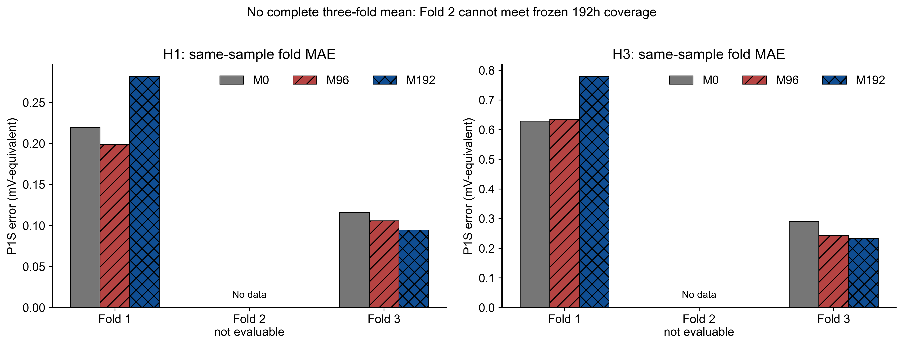
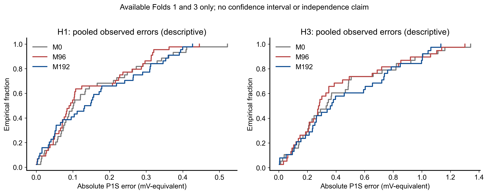

# 长历史收益判断

正式H1：**NOT_EVALUABLE**；辅助H3：**NOT_EVALUABLE**。缺第2fold，未达到预设完整三fold评价资格，不宣称CLEAR_GAIN或统计显著性。

|horizon|scope|candidate|baseline|difference_MAE_mV|relative_improvement_percent|status|
|---|---|---|---|---|---|---|
|H1|fold_1|M96|M0|-0.020687|9.419626|COMPARABLE_SAME_POINTS|
|H1|fold_2|M96|M0|不可评价|不可评价|NOT_EVALUABLE|
|H1|fold_3|M96|M0|-0.010059|8.681290|COMPARABLE_SAME_POINTS|
|H1|AVAILABLE_2_FOLDS_DIAGNOSTIC_ONLY|M96|M0|-0.015373|9.164628|NOT_FORMAL_3_FOLD_RESULT|
|H1|fold_1|M192|M0|0.062014|-28.237154|COMPARABLE_SAME_POINTS|
|H1|fold_2|M192|M0|不可评价|不可评价|NOT_EVALUABLE|
|H1|fold_3|M192|M0|-0.021273|18.359829|COMPARABLE_SAME_POINTS|
|H1|AVAILABLE_2_FOLDS_DIAGNOSTIC_ONLY|M192|M0|0.020371|-12.144055|NOT_FORMAL_3_FOLD_RESULT|
|H1|fold_1|M192|M96|0.082702|-41.572781|COMPARABLE_SAME_POINTS|
|H1|fold_2|M192|M96|不可评价|不可评价|NOT_EVALUABLE|
|H1|fold_3|M192|M96|-0.011214|10.598638|COMPARABLE_SAME_POINTS|
|H1|AVAILABLE_2_FOLDS_DIAGNOSTIC_ONLY|M192|M96|0.035744|-23.458574|NOT_FORMAL_3_FOLD_RESULT|
|H3|fold_1|M96|M0|0.005552|-0.882417|COMPARABLE_SAME_POINTS|
|H3|fold_2|M96|M0|不可评价|不可评价|NOT_EVALUABLE|
|H3|fold_3|M96|M0|-0.047428|16.334630|COMPARABLE_SAME_POINTS|
|H3|AVAILABLE_2_FOLDS_DIAGNOSTIC_ONLY|M96|M0|-0.020938|4.554247|NOT_FORMAL_3_FOLD_RESULT|
|H3|fold_1|M192|M0|0.149909|-23.827091|COMPARABLE_SAME_POINTS|
|H3|fold_2|M192|M0|不可评价|不可评价|NOT_EVALUABLE|
|H3|fold_3|M192|M0|-0.056604|19.494901|COMPARABLE_SAME_POINTS|
|H3|AVAILABLE_2_FOLDS_DIAGNOSTIC_ONLY|M192|M0|0.046652|-10.147212|NOT_FORMAL_3_FOLD_RESULT|
|H3|fold_1|M192|M96|0.144357|-22.743977|COMPARABLE_SAME_POINTS|
|H3|fold_2|M192|M96|不可评价|不可评价|NOT_EVALUABLE|
|H3|fold_3|M192|M96|-0.009176|3.777275|COMPARABLE_SAME_POINTS|
|H3|AVAILABLE_2_FOLDS_DIAGNOSTIC_ONLY|M192|M96|0.067590|-15.402947|NOT_FORMAL_3_FOLD_RESULT|

负difference表示候选较好，正relative_improvement表示改善。正式门槛不改：H1三fold等权MAE低于M96至少5%、至少2fold胜M96且低于Persistence；缺fold不能用两fold均值代替。H3独立报告，不顶替H1主结论。

若可用fold中观察到局部收益，只能称有限同堆诊断信号；样本损失、共同scope、fold3和极端误差均需一并解释。没有按结果改192/96h、特征、alpha网格或数据划分，没有挑最漂亮的fold。

## 最后fold与总体诊断为什么不同

H1 Fold1：192h 0.281635高于96h 0.198933；Fold3：192h 0.094593低于96h 0.105807。H3 Fold1：192h 0.779061高于96h 0.634704；Fold3：192h 0.233750低于96h 0.242926。更长历史在最后fold表现较好，但首fold损失更大，未形成总体优势，不能只保留最后一fold。

192h模型的P95/max在某些scope较好并不替代主MAE；完整尾部指标均保留。不同时间段的趋势/恢复和训练信息分布可能影响历史效用，但本轮没有独立因果机制检验，不把这一推测当作已证解释。
