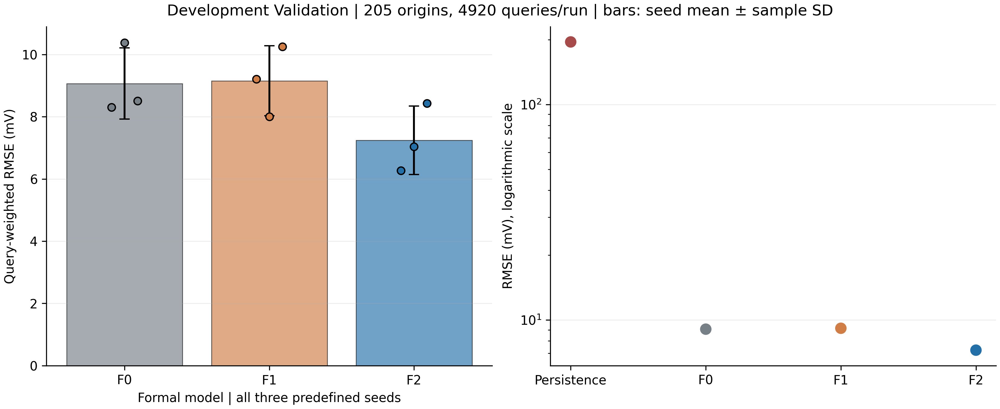
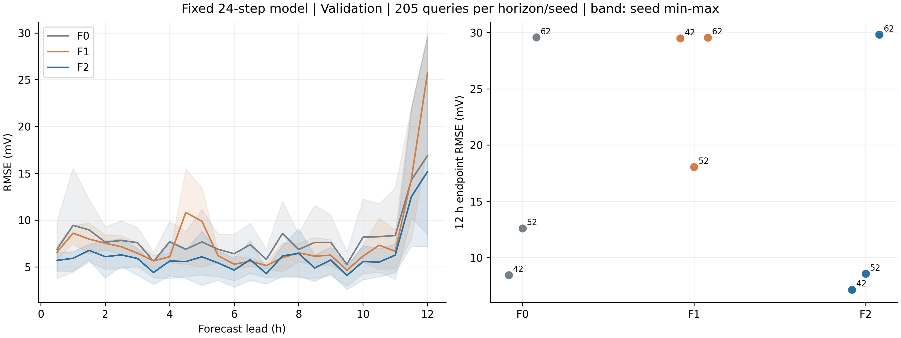
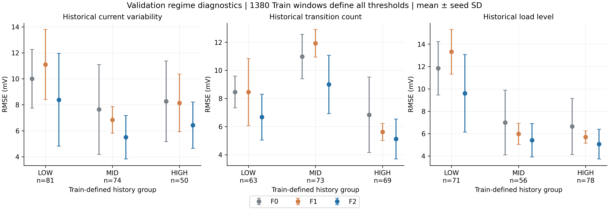
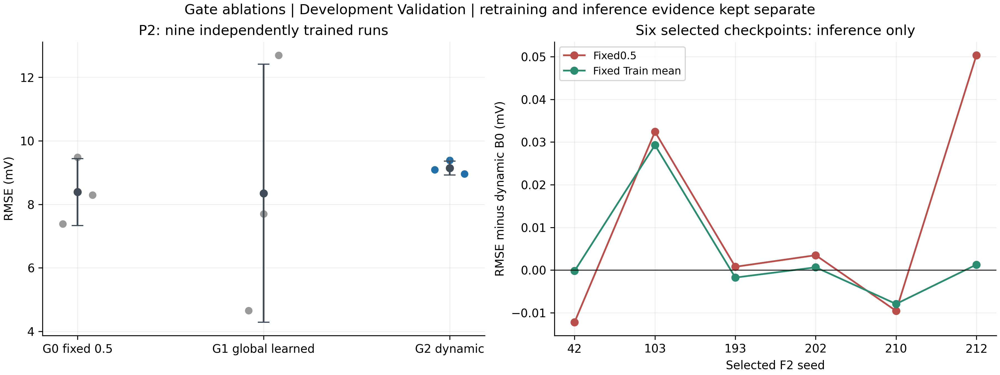
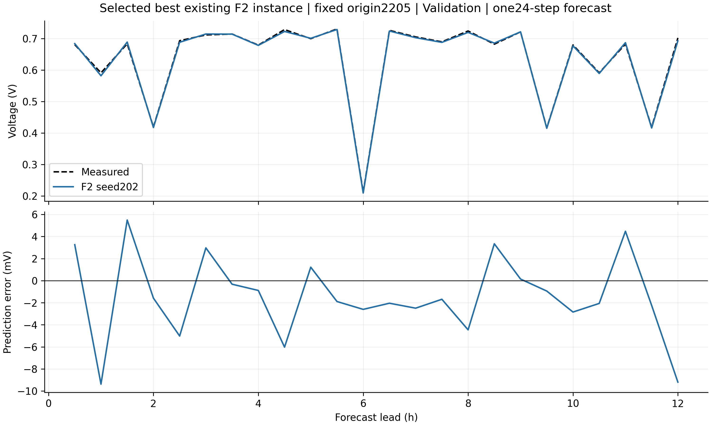
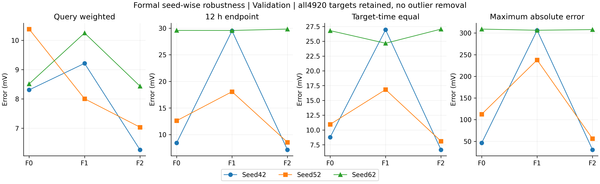
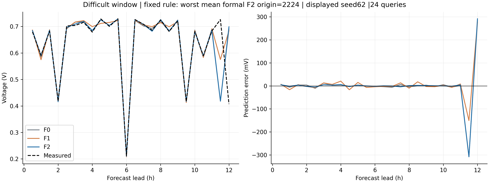

# 5. Results and discussion

## 5.1 同协议整体预测表现

双路径F2在冻结Development Validation上取得了较低的整体预测误差。表T04保留F0、F1、F2的全部三个预定Seed和同样本Persistence结果，每个模型均评价205个起点、4920个预测查询及251个唯一目标时刻。三个Seed的F2 RMSE为6.2652、7.0346和8.4364 mV，均低于相同Seed的F0与F1。按每Seed RMSE等权汇总，F0、F1和F2分别为9.067563±1.142630、9.155598±1.122666和7.245400±1.100853 mV。这里的离散量为三个初始化结果的样本标准差，不是置信区间。

**表T04　共同Validation上的完整模型与Seed比较。Persistence只有一次确定性计算，Seed=-1仅为存储标识。**

|模型|Seed|RMSE/mV|MAE/mV|R²(ΔV)|
|---|---|---|---|---|
|F0|42|8.3072|6.4135|0.998187|
|F0|52|10.3815|7.0297|0.997168|
|F0|62|8.5140|3.3163|0.998095|
|F1|42|9.2127|4.3654|0.997770|
|F1|52|8.0055|4.8620|0.998316|
|F1|62|10.2486|5.7261|0.997240|
|F2|42|6.2652|4.7042|0.998969|
|F2|52|7.0346|5.0334|0.998700|
|F2|62|8.4364|3.0851|0.998130|
|Persistence|-1|195.0786|119.7985|-0.000032|

F2相对F0和F1的等Seed平均RMSE分别降低20.0954%和20.8637%。这两个比例由模型RMSE均值之比计算，不能与逐Seed相对改善率的均值混用。图F04同时显示单个Seed与汇总结果，使整体优势及初始化差异均可见。F1均值略高于F0，且仅一个Seed的整体RMSE更低，说明增加卷积分支本身尚未形成一致收益。F2是整体配置的经验优势，组件归因还需独立对照。

同一组预测键上的Persistence采用零电压增量，RMSE为195.078555 mV，MAE为119.798476 mV。保持起点电压难以跟随动态负载造成的电压变化，因此该对照主要验证模型确实超越简单静态保持。它属于较弱基线，不能替代同协议LSTM或TCN。表中的R²针对ΔV，其较高取值也不能代替绝对误差、末端误差或健康状态验证。

平均MAE也支持F2的整体误差降低：F0、F1、F2依次为5.5865、4.9845和4.2743 mV。但MAE对少量大残差的敏感程度低于RMSE，不能据此忽略尾部。恢复绝对电压时，预测与真值共享同一个原始起点电压，因此它们的残差与ΔV残差相同，图中电压单位和表中误差单位可以一致转换。高R²主要描述该目标方差下的拟合程度，不能作为健康信息已被识别的证明。

这一比较沿用已冻结特征、缩放和权重，不重新训练。本轮800项独立指标检查的最大数值差为5.6843×10⁻¹⁴，核验对象为九模型与Persistence的49200个查询。复算一致支持结果可追溯性，不能增加评价数据的独立性。

## 5.2 固定24步预测的距离误差与终点表现

图F05评价同一个24步输出模型在不同预测位置的误差，每一步均有205个预测值。它检验误差随预测距离的变化，不代表分别训练了24种输出长度。F2三个Seed在12h终点的RMSE为7.1461、8.5556和29.8174 mV，等Seed均值为15.1731 mV。前两个Seed的终点误差较低，第三个Seed则出现明显恶化。整体7.2454 mV无法完整表达12h终点的风险。

[Benaggoune等（2022）](https://doi.org/10.1016/j.apenergy.2022.118835)将多步块预测与后续真实测量更新结合，[Chou与Wang（2025）](https://doi.org/10.1016/j.renene.2025.123019)研究滚动预测，[Wei等（2026）](https://doi.org/10.1016/j.jpowsour.2026.239941)的多步讨论采用自回归描述。这些工作有助于组织跨度分析，但与本文同起点直接24步输出的信息条件不同。本研究的12h长度是固定任务范围，现有结果不足以支持任意远期预测。

## 5.3 历史工况分组下的表现

F2的平均优势在九个历史工况组中均存在，但逐Seed方向并不完全一致。分组分别依据过去48步的电流密度标准差、负载转换次数和平均电流密度，其阈值只由1380个Train历史窗口确定。三组低/中/高起点数量分别为81/74/50、63/73/69和71/56/78。每一种划组均覆盖同一批205个Validation起点，跨划组的窗口重复出现。

**表T09　全部历史组的同Seed差值。负值表示F2平均RMSE更低，胜出数保留三个初始化的方向。**

|历史划组|等级|起点数|F2−F0均值/mV|对F0胜出|F2−F1均值/mV|对F1胜出|
|---|---|---|---|---|---|---|
|电流密度波动|LOW|81|-1.6225|2/3|-2.7135|2/3|
|电流密度波动|MID|74|-2.1382|3/3|-1.3403|2/3|
|电流密度波动|HIGH|50|-1.8456|3/3|-1.7143|2/3|
|负载转换次数|LOW|63|-1.7850|3/3|-1.7780|2/3|
|负载转换次数|MID|73|-1.9850|2/3|-2.9297|3/3|
|负载转换次数|HIGH|69|-1.7193|3/3|-0.5039|1/3|
|平均电流密度|LOW|71|-2.2361|3/3|-3.7124|3/3|
|平均电流密度|MID|56|-1.5846|3/3|-0.5694|1/3|
|平均电流密度|HIGH|78|-1.5734|3/3|-0.6339|2/3|

九组F2等Seed平均RMSE均低于F0和F1，表明整体优势并非只由某一个历史负载层级形成。然而，电流波动LOW组对F0只有2/3胜出，平均负载MID及转换次数HIGH组对F1都只有1/3胜出。因此，相同组内的均值优势可与多数Seed不占优同时发生，不能写成每种工况均稳定提升。图F06展示组别、样本数及差异，并未依据Validation误差重新调整边界。

平均电流密度的Train三分位边界约为0.6939和0.6988 A/cm²，说明LOW与HIGH只是历史均值的相对排序，二者不等于瞬时负载始终处于低值或高值。历史均值还会压缩窗口内的负载差异，因此本研究同时保留波动与转换次数两种划组。各组数量由冻结阈值自然形成，并未强制Validation等样本，也没有依据结果合并不利组。

这些阈值是相对Train分布的统计等级，不能作为通用低负载或高波动的物理标准。分组也没有控制温度、湿度和压力。与[Li等（2023）](https://doi.org/10.1016/j.ijhydene.2023.03.316)按实际负载级呈现预测曲线不同，本节研究的是预测起点已知的历史状态。它避免将未来真实工况作为在线输入，但不构成九套独立工况数据或电化学因果识别。

## 5.4 双路径与动态门控的证据强弱

门控确实参与了预测计算，其独立精度贡献尚未获得支持。六个筛选实例的g都随历史输入变化，固定或置换g会改变预测。g控制的是encoder特征混合比例，不能直接解释为两条路径对最终电压预测的贡献百分比。不同初始化面对同一历史输入的响应方向也有差异，15对门控秩相关范围为−0.996603至0.987941，其中Seed210与多数模型的电流波动响应方向相反。

对同一checkpoint固定g=0.5后，4/6实例RMSE变差，平均增加0.010890 mV。使用各模型Train历史平均g时，仅3/6变差，平均增加0.003566 mV。十次预定置换中43/60次误差增加，各Seed置换均值有5/6变差，总体平均增加0.016604 mV。差异规模很小，且方向不一致。固定0.5的推理扰动没有重新学习其他参数，不能直接称为重新训练的F1。

独立训练G0、G1和G2分别采用固定融合、全局可学习比例和历史条件门控，其三个Seed的均值RMSE为8.387048、8.349936和9.143434 mV。G2相对两对照平均分别增加0.756386和0.793498 mV，配对均只有1/3胜出，未达到事先规定的0.5mV平均改善和逐Seed限制。图F07将训练对照与推理扰动分开，避免以选后实例的小幅优势覆盖独立训练的负面证据。

门控幅度也不直接衡量其价值。两条路径表征的尺度、冗余程度以及后续非线性处理，都可能使较明显的g变化只产生较小的最终预测变化。反之，某个固定比例在现有权重下表现较好，也不能推导出从头训练时该比例最优。推理反事实在此用于揭示已训练函数的依赖，而独立训练对照用于评价设计选择，二者的问题和解释范围应保持区分。

因此，当前可陈述历史工况依赖的双路径融合已实现并被检验，不能陈述动态门控独立、稳定提高精度。相关性和推理敏感性揭示模型依赖，受控训练才更直接回答设计收益。两类证据共同约束创新主张，而不是择取其中有利部分。

## 5.5 六个优质实例与选择偏差

已有六实例表明冻结F2可以产生误差较低的训练结果，但它们来自Validation筛选。表T06完整列出六个实例，最佳Seed202的RMSE为3.9123 mV。图F08采用筛选阶段已经固定的起点2205，展示单一12h预测，不拼接重叠窗口，也不以该曲线重新选择模型。

**表T06　筛选后实例，不能作为无偏随机Seed总体或正式结构比较。**

|筛选Seed|RMSE/mV|MAE/mV|12h终点RMSE/mV|最大绝对误差/mV|
|---|---|---|---|---|
|42|6.2652|4.7042|7.1461|30.5175|
|103|4.9959|3.8295|4.7940|24.8627|
|193|5.3954|4.0322|5.4291|33.6604|
|202|3.9123|3.0092|4.4606|23.0644|
|210|5.6800|4.3661|6.2041|25.4494|
|212|4.1475|3.1533|4.2869|24.8128|

第一轮设置8h总运行安全预算，注册并启动20个新Seed，18个完成。Seed101因首批日志序列化错误在零训练步时失败，151因训练中的Windows状态文件替换错误中断，失败记录及151的partial checkpoint均保留且未重跑，不能将它们记为预测精度未达标。第二轮设置12h安全预算，注册201至250共50个候选，实际依次完成201至212的12个，取得202、210和212三个新合格实例后停止，余38个未启动。两轮共32次新增尝试、30次成功，Seed42另来自历史H。图F09保留完整完成分布与筛选结果，未把失败或未启动候选隐去。

六实例经回顾性同口径核对，均满足第二轮预先冻结的A级与B级条件，即整体RMSE≤6.3mV、终点RMSE≤10mV、最大误差≤50mV。这些阈值制定时第一轮结果已经可见，不能将对历史实例的回查追认为第一轮的预注册成功。条件核对与两轮筛选也都使用了同一Validation。将其均值与未经相同筛选的F0/F1均值比较会混合架构和选择效应。本文主比较始终使用H的三个预定Seed，六实例仅证明存在良好实现并提供机制诊断对象，不能证明一般初始化的期望表现。

## 5.6 尾部、困难窗口与目标等权敏感性

Seed62说明整体误差降低与末端可靠性并不等价。表T04-S保留同Seed三个模型的全部敏感性对照。F2整体RMSE低于两者，但终点和目标等权均更高，最大误差也略高于F1。较低的P99与较大的最大误差并存，表明少量极端残差不能由分位数概括消除。

**表T04-S　Seed62同样本敏感性对照，单位均为mV。**

|模型|Seed|整体RMSE/mV|12h终点RMSE/mV|目标等权RMSE/mV|P99/mV|最大绝对误差/mV|
|---|---|---|---|---|---|---|
|F0|62|8.5140|29.5735|26.7988|13.5583|309.0627|
|F1|62|10.2486|29.5625|24.6631|24.1329|306.4147|
|F2|62|8.4364|29.8174|27.0539|12.0616|307.9849|

图F11按三个正式F2模型平均窗口RMSE最大这一诊断规则选择起点2224，展示相同起点的完整24步预测。Seed62在目标2247和2248，即第23、24步出现大幅错配，最大绝对误差达到307.9849 mV。该规则只用于事后展示困难样本，不参与训练或模型选择。现有缓存能够定位误差，却不能唯一判定其来自某种物理故障、运行转换或软件原因。

图F12进一步保留各目标的SSE贡献。4920个查询包含重复目标，正式查询等权评价会赋予高重数目标更多权重。目标时间等权先在每个目标内平均平方误差，再对目标等权，因而能揭示另一种风险分布。F2 Seed62在此口径升至27.0539 mV，说明少量低重数大误差对整体查询RMSE的影响可能受稀释。两种口径回答的问题不同，不能事后择取有利指标，也不能先平均预测制造集成性能。251个去重时刻仍具有时间依赖，本文不据重叠查询进行显著性检验。

## 5.7 可用范围与泛化限制

本文结果限于一条RealHyFC轨迹及已复用的Development评价。历史I2汇总中F2等Seed RMSE为12.1971±6.3938 mV，三个Seed范围5.1653至17.6615 mV。它在该区域仍优于同Seed对照，但绝对误差和离散性提示Validation上的表现不能直接外推。表T10仅复用已保存汇总，本轮未读取其逐点预测、重新推理或据此选择新模型。

该Assessment已经参与历史研究反馈，不具独立Test身份。现有资格审计也未确认另一个合法、未受设计反馈影响的区域。由此不能宣称独立泛化已经成立，同样不能把独立性未知写成F2使用Test标签训练已被证实。与文献进行比较时，必须保留数据集、电堆尺度、采样、平滑及未来输入的差异，不按跨论文绝对RMSE排名。Tu与Yakut尚缺完整正文，其未知实验设计不能被叙述为文献空白。

预测不确定性也尚未经过独立校准。三个初始化的标准差反映训练随机性的一部分，六个筛选实例则已经受到选择条件影响，二者都不能直接转换为给定预测时刻的可信覆盖区间。本文据此报告点预测误差和风险分布，不额外宣称在线决策保障。

现有证据支持冻结配置的Development经验价值，仍缺同协议简单LSTM/TCN基线及合格独立验证。旧N2虽有这些模型，却使用不同划分和预算，不能直接拼入本文排名。补齐这两项证据比扩大Seed筛选或重新优化门控更能回答方法是否具有可重复的应用价值。

## 工作稿溯源（投稿整理时移入补充材料）

主数值：`outputs/experiment_tables/PAPER_NUMERIC_FACTS.json`、`FORMAL_VALIDATION_METRICS.csv`、`EQUAL_SEED_SUMMARY.csv`、`HORIZON_METRICS.csv`。分组：`outputs/condition_analysis/CONDITION_METRICS.csv`和`PAIRED_REGIME_COMPARISONS.csv`，表T09。消融/筛选：表T06、T07、`SIX_GATE_INTERVENTIONS.csv`、`ALL_COMPLETED_SCREENED_SEEDS.csv`。案例/集中性：`CASE_SELECTION.csv`、`DIFFICULT_WINDOW_DATA.csv`、`TARGET_SSE.csv`。历史Assessment仅表T10。图号和源码由`outputs/evidence_index/FIGURE_INDEX.csv`固定。

对应Claim IDs：C01–C25、C28–C32。所有性能图为Development，六实例为筛选后诊断，SD不作为置信区间。原始预测、极端误差和失败筛选均保留。
