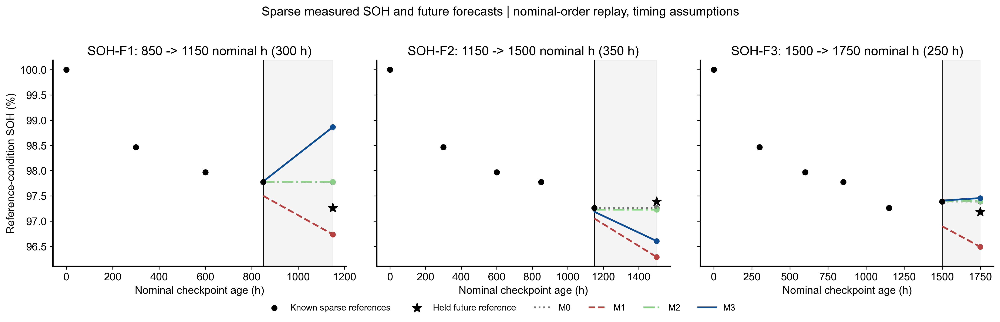

# 三个固定未来目标的全部数值

本表“正式”指本轮冻结四法三目标真实执行的输出，不代表严格实时在线确认。所有行的scope=NOMINAL_CHECKPOINT_ORDER_REPLAY、strict_online_time_qualified=False。

|task_id|method|nominal_horizon_h|target_SOH|prediction|signed_error_pp|absolute_error_pp|
|---|---|---|---|---|---|---|
|SOH-F1|M0|300|0.972623|0.977740|0.511696|0.511696|
|SOH-F1|M1|300|0.972623|0.967351|-0.527198|0.527198|
|SOH-F1|M2|300|0.972623|0.977781|0.515732|0.515732|
|SOH-F1|M3|300|0.972623|0.988639|1.601544|1.601544|
|SOH-F2|M0|350|0.973863|0.972623|-0.123993|0.123993|
|SOH-F2|M1|350|0.973863|0.962884|-1.097929|1.097929|
|SOH-F2|M2|350|0.973863|0.972268|-0.159476|0.159476|
|SOH-F2|M3|350|0.973863|0.966056|-0.780766|0.780766|
|SOH-F3|M0|250|0.971785|0.973863|0.207829|0.207829|
|SOH-F3|M1|250|0.971785|0.964901|-0.688386|0.688386|
|SOH-F3|M2|250|0.971785|0.973990|0.220511|0.220511|
|SOH-F3|M3|250|0.971785|0.974559|0.277444|0.277444|

完整17位数值见predictions.csv。signed error=预测−参考，正数高估；绝对误差单位SOH百分点。未来目标实际SOH是保存的CHM参考值，没有用真实未来P1S进行预测。没有删点，没有添加额外起点、种子或重训。

M0真实MAE=0.281172489423 pp，M1=0.771170888468 pp（四位小数0.7712），与指令中的约0.7714差0.000229111532 pp。已核对BoL=1、标称0h坐标、包含起点的全部历史参考规则、CHM全精度来源及保持率×100单位；独立OLS重算一致，保留真实输出，不硬编码覆盖近似预期。独立numpy.linalg.lstsq与执行器centered covariance不同实现重算12值，最大差异见INDEPENDENT_VERIFICATION.json。

黑点/黑星是真实稀疏参考；连续彩线只是固定方法预测，不是实际连续SOH。图中小时是标称情景坐标，不能称精确运行时间。
