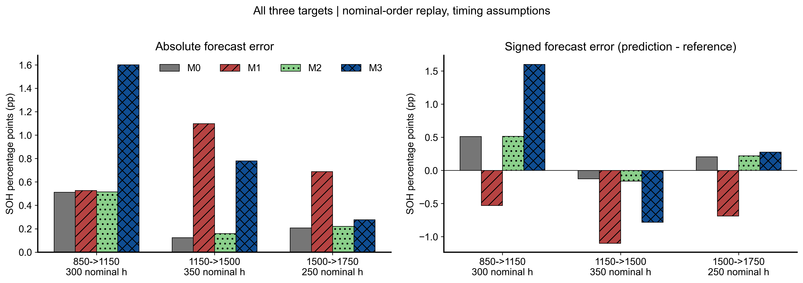
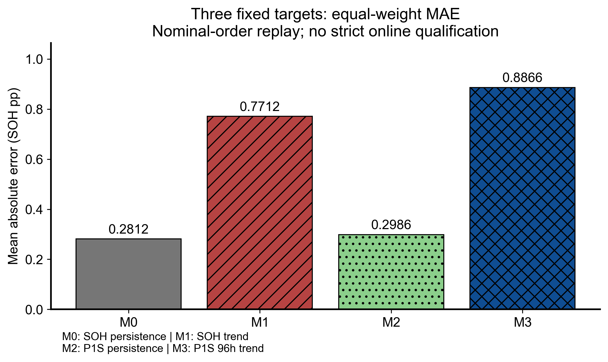

# 四法比较及固定判断

|method|n_computed|MAE_pp|RMSE_pp|wins_vs_M0|improvement_vs_M0_percent|research_decision|
|---|---|---|---|---|---|---|
|M0|3|0.281172|0.326803|0|0.000000|REFERENCE_BASELINE|
|M1|3|0.771171|0.807725|0|-174.269681|NO_GAIN|
|M2|3|0.298573|0.336669|0|-6.188548|NO_GAIN|
|M3|3|0.886585|1.041076|0|-215.317005|NO_GAIN|

|candidate|baseline|MAE_difference_pp|improvement_percent|wins|common_targets|
|---|---|---|---|---|---|
|M2|M0|0.017400|-6.188548|0|3|
|M3|M2|0.588012|-196.940688|0|3|
|M3|M0|0.605412|-215.317005|0|3|
|M3|M1|0.115414|-14.966045|2|3|

MAE_difference_pp=候选−对照，负数更好。n=3是同一堆三个相关固定目标，不是三个独立寿命。这里没有缺失数值；若候选缺失，代码保留该行并拒绝完整三点判定，不能比较不同覆盖均值。

数字门槛固定为MAE至少比M0低5%且至少2/3目标更好；不能据结果修改。时间资格未知时，即使数字门槛满足也不得宣称正式CLEAR_GAIN；改善最多是LIMITED_SIGNAL，无法证明严格在线的评价为NOT_EVALUABLE。未改善者按NO_GAIN报告，而非追加参数寻找新优势。

M3相对M2的对照隔离了长期外推贡献。不能用M2的当前SOH估计优势替代M3未来趋势预测优势，也不能以某单点取代全三点主MAE。

## 逐点误差归因

1150h的实际SOH为0.9726232681；M3预测0.9886387126，局部上升斜率被外推到未来，误差1.601544 pp。1500h实际恢复到0.9738631957；M1/M3分别预测0.9628839076/0.9660555384，误差1.097929/0.780766 pp。1750h的四法误差为0.207829/0.688386/0.220511/0.277444 pp。长期单调退化假设无法自动解释这些动态恢复。这里只说明预测公式和已保存健康proxy走势的对应，不声称已识别电化学因果机制。

在本回放中，M2相对M0的MAE增加6.19%，M3增加215.32%；M3相对M2增加196.94%。原点信息校准未带来改善，长期外推进一步放大误差。完整误差贡献见outputs/ERROR_CONTRIBUTIONS.csv。
