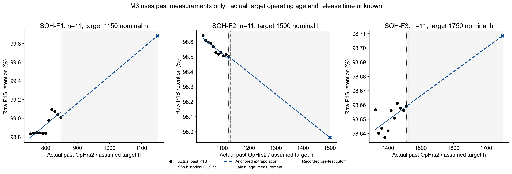

# 研究限制和下一步

本轮完成实际CPU数值和PNG/PDF图表，不停留于规划。最低回放MAE是M0（0.281172 pp）；是否值得继续看完整四法及三点对照，而不是升级网络名称。

主要限制：极化缺实际OpHrs2和结果发布时间；M3用标称目标坐标替代实际年龄；96h局部趋势被外推约250～350h，未来恢复/工况和校准稳定性未知；固定PAA映射部分median不在共同支持，保留全部；单堆稀疏三目标、共享BoL与年龄混杂，不能证明跨堆泛化。

先补源时间身份，明确标称原点的真正预测发布时刻及计划中的未来运行小时；利用已保存结果定位是当前proxy校准还是局部斜率外推造成误差。对未胜简单模型的M3不改变96h、目标或公式救回结果，不开展GPU大搜索。

只有更多独立、合法时间可获得的参考观测，以及同预算简单对照证据支持P1S未来外推时，才值得另立神经网络研究；目前优先简单模型和数据资格。现有TFT动态双路径模型保持冻结，本阶段没有把其12h电压输出改成SOH。

图4黑点是使用的历史raw P1S；实线是过去96h拟合，虚线是锚定最新R的外推。灰区不是实际观测，目标横坐标采用标称代入，pre-test cutoff仅已有记录不是极化完成年龄。
