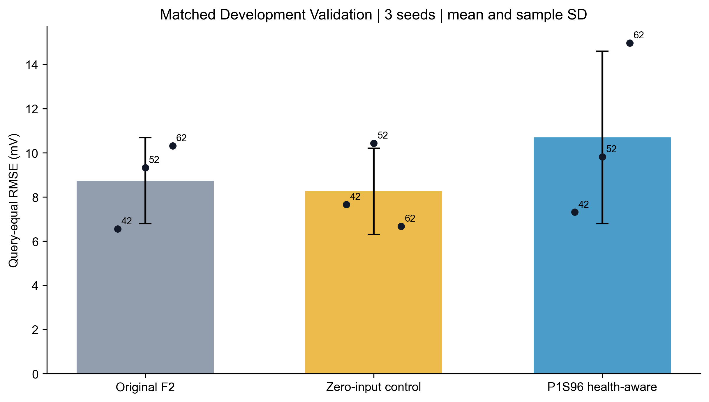

# 96h健康感知TFT：最终实际结果

健康上下文未超过两个正式对照，不支持将其升级为有效创新。 最终状态：`HEALTH_CONTEXT_NO_CLEAR_GAIN`。

1. 合法匹配870个Train、178个Validation起点，Validation覆盖224个去重目标时间行；原1380/205窗口严格复现。保守P1S可获得时刻、96h跨度和模型参数时间隔离均通过。
2. 健康模型和两个对照均实际完成三个Seed训练，共九次，无正式失败重试。H原450上限/pat40/AdamW/学习率/batch32及全部核心结构保持不变。
3. 原F2_MATCHED三Seed平均RMSE：8.734973mV。
4. 加入健康上下文后三Seed平均RMSE：10.702212mV；零输入同参数对照为8.260648mV。
5. 相对原F2改善-22.5214%，相对参数对照改善-29.5566%。
6. 相同B/C参数与初始化用于区分真实P1S信息贡献；不能把仅B/A数值差异说成健康收益。完整配对结果见05。
7. 同时优于两个对照的Seed为0/3，逐Seed与末端真实数据均保留。末端评价：fail；12h末端三Seed均值由原F2的20.568706mV升至26.259189mV，恶化27.67%；相对零输入对照11.528875mV恶化127.77%。健康模型三个Seed的末端误差均高于原F2，Seed62由23.585606升至39.607370mV，存在明显恶化。目标时刻等权误差、P95/P99及最大误差均完整公开，不以个别Seed优于参数对照替代失败的主指标。
8. 健康上下文未超过两个正式对照，不支持将其升级为有效创新。不宣称独立Test优越或统计显著性，历史P2/P3负面消融结论保留。
9. 后续M2/软物理需要分别认证，当前仅保留接口，本轮不加入、不自动扩展。

| model | Seed42_RMSE_mV | Seed52_RMSE_mV | Seed62_RMSE_mV | mean_RMSE_mV | sample_SD_mV |
| --- | --- | --- | --- | --- | --- |
| F2_MATCHED | 6.557868 | 9.327468 | 10.319583 | 8.734973 | 1.949593 |
| F2_CAPACITY_CONTROL | 7.664547 | 10.440401 | 6.676996 | 8.260648 | 1.951232 |
| F2_P1S96_HEALTH_AWARE | 7.313528 | 9.820168 | 14.972941 | 10.702212 | 3.905145 |

所有本轮误差均为真实动态DeltaV电压预测mV，不是P1S mV-equivalent，也不是SOH/RUL误差。主指标按178×24个预测查询等权；三Seed均值为三次独立运行RMSE的算术平均。重叠查询与去重时间行不意味着统计独立。

15项测试、GPU合成前后向/optimizer/保存重载预检及正式checkpoint重载通过。正式前Windows保存句柄修复留档，未改变模型或门槛。全部源文件与训练代码按最终冻结协议校验；真实预测/指标CSV由独立脚本复算，所有文件只在新阶段。

代码和输入身份：configs/FROZEN_PROTOCOL.json及SHA、inputs/INPUT_FINGERPRINTS.json；真实成绩：outputs/ALL_RUN_METRICS.csv、PAIRED_SEED_COMPARISONS.csv；checkpoint与训练记录：outputs/checkpoints和training_logs；判定：outputs/RESEARCH_DECISION.json。

本轮到此停止，不追加窗口、模型、Seed、M2训练、物理loss或RUL实验。历史目录只读，完成后仅提交本阶段并安全推送main。

补充独立核验：全部1585个起点的P1S事件选择及1048个合格健康向量通过独立最小二乘重建，最大特征差2.71e-20；38,448条真实预测逐点身份、指标复算和九个checkpoint身份全部通过。正式训练共3050个epoch，累计训练计时约4.668小时，正式失败/重试均为0。
