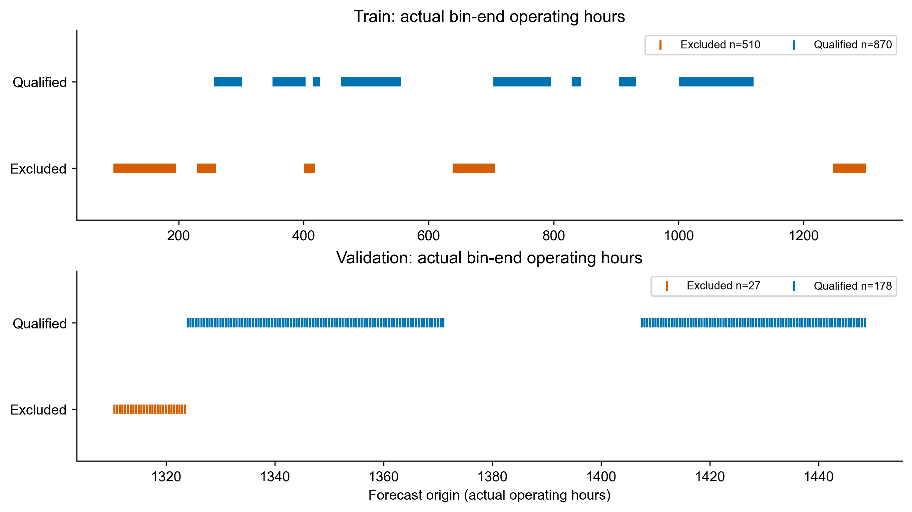

# P1S与TFT时间对齐

P1S身份来自冻结的131条Development实际测量缓存，不重新解析Raw。保持率R=V_P1S/0.71383023635，参考可获得时刻171.82091h；完整物理周期1–10仅作参考，输入测量从周期11开始。每条保留raw_cycle_id、middle_50测量起止时间、保守可获得时间、完整周期资格。

TFT起点取原始bin_end_ophrs2_h，不使用row index×0.5。测量的实际结束时刻须在[t-96,t]内，且conservative_available_end_h<=t；同一周期不重复计数。五项特征为最新R、均值、总体标准差、按实际测量结束小时的线性斜率、最新值减中位数。没有未来P1S补齐、全序列平滑或回顾性SOH映射。

| role | original_origins | qualified_origins | excluded_origins | distinct_target_rows | COUNT_BELOW_5 | SPAN_BELOW_67_2_H | REFERENCE_NOT_YET_AVAILABLE | TIME_IDENTITY_AMBIGUOUS |
| --- | --- | --- | --- | --- | --- | --- | --- | --- |
| train | 1380 | 870 | 510 | 1054 | 191 | 169 | 150 | 0 |
| validation | 205 | 178 | 27 | 224 | 0 | 27 | 0 | 0 |

| role | origin_min_h | origin_max_h | target_min_h | target_max_h | latest_P1S_age_min_h | latest_P1S_age_median_h | latest_P1S_age_max_h |
| --- | --- | --- | --- | --- | --- | --- | --- |
| train | 258.500000 | 1118.500000 | 259.000000 | 1130.500000 | 0.015840 | 4.549670 | 9.517490 |
| validation | 1324.000000 | 1448.500000 | 1324.500000 | 1460.500000 | 0.180000 | 4.915000 | 9.500000 |

时间字段区分：给定缓存的保守P1S可获得时刻与完整周期终点不同，目录中的周期终点还晚约0.69–0.70h。本轮按用户指定的P1S保守可获得字段判断测量值已完成，完整周期身份沿用冻结事后目录，不声称完成在线周期完整性判定；没有把后续周期尾段的测量值输入模型。两种时刻逐条对照另存P1S_AVAILABILITY_VS_CYCLE_END.csv。

这里只统计同规则允许的预测起点，不按预测结果筛样本。P1S_TFT_ALIGNMENT.csv逐条保留全部1585个原起点的资格及原因、测量周期名单、最新测量距离起点的小时差；P1S_HISTORY_TIME_IDENTITIES.json保留真实测量结束/可获得时刻。

3007行限定读取后以年龄边界筛到3005行，构造Train [0,2103)和Validation [2103,2404)，复现1380/205原窗口。没有Assessment窗口或Test推理。匹配后Train末端标签1130.5h，首个Validation起点1324h，满足模型参数时间隔离。

