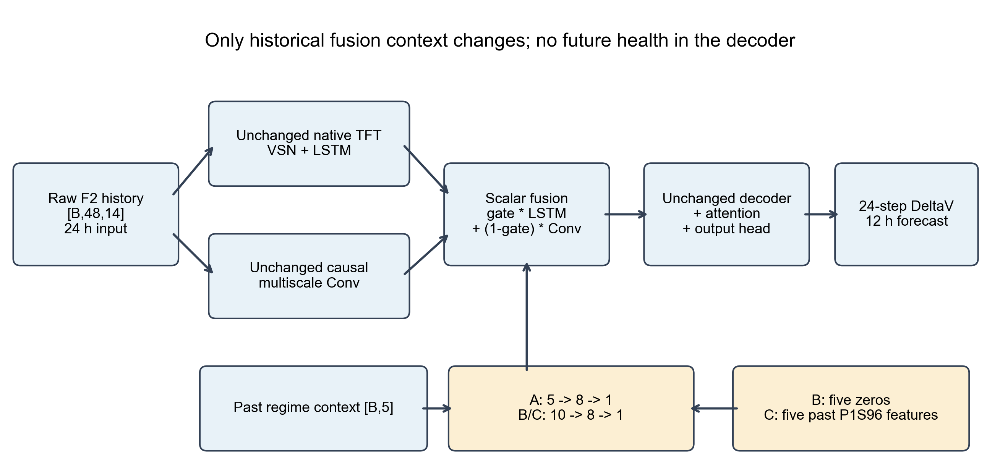

# 健康感知融合结构

只在本阶段继承原F2，直接只读导入原Canonical TFT、双路径和因果多尺度卷积类；未复制修改编码器forward。48×14历史输入、24步DeltaV输出、hidden64/continuous32、LSTM一层、四头注意力、原decoder和head保持不变。decoder仍只有确定性相对预测步，不加入未来实测工况或健康特征。

|模型|门控输入|MLP|用途|
|---|---|---|---|
|F2_MATCHED|历史工况5项|5→8→1|同样本、从头训练的原F2|
|F2_CAPACITY_CONTROL|历史工况5项+5维零|10→8→1|与健康模型等参数对照|
|F2_P1S96_HEALTH_AWARE|历史工况5项+历史健康5项|10→8→1|检查真实P1S信息贡献|

原工况按冻结的scaled/masked encoder槽位历史均值取得：load_transition_count、zero_current_fraction、actual_current_density_A_cm2_std、actual_current_A_std、actual_current_density_A_cm2_mean。ELU及sigmoid沿用原门控。融合仍为gate×LSTM+(1-gate)×Conv，标量扩展广播到编码器，不复制健康值到未来decoder。

| model | total_trainable_parameters | gate_parameters | additional_parameters |
| --- | --- | --- | --- |
| F2_MATCHED | 332436 | 57 | 0 |
| F2_CAPACITY_CONTROL | 332476 | 97 | 40 |
| F2_P1S96_HEALTH_AWARE | 332476 | 97 | 40 |

同Seed以新建原F2作为共同参数模板；B/C共用同一扩展门控，原5列权重、bias和output层沿用A，新5列从独立seed+100000初始化。原output零初始化使三组初始gate完全为0.5，CPU初始预测完全一致。模型构造后重置训练RNG，DataLoader单独按Seed设置，逐共同epoch核验采样顺序。

新增仅40个名义参数。B的新增列始终乘零，对数据损失的梯度为零，因此不会增加有效健康信息或有效表达能力；AdamW仍按同一协议处理全部参数。B与A后续可能因不同矩阵形状/CUDA非严格确定性产生数值训练差异，不能把这种差异自动解释成额外健康收益。C与B参数和初始化相同，只有真实P1S进入门控的有效信息不同。

Raw F2 scaler沿用原全部1380个合法未滤波Train窗口，和历史E/F hash逐项一致；健康scaler只在匹配后的870个Train健康向量拟合。Top10与逐窗口EWMA .3不变。原96h Ridge的H1/H3未来预测没有作为TFT输入。

