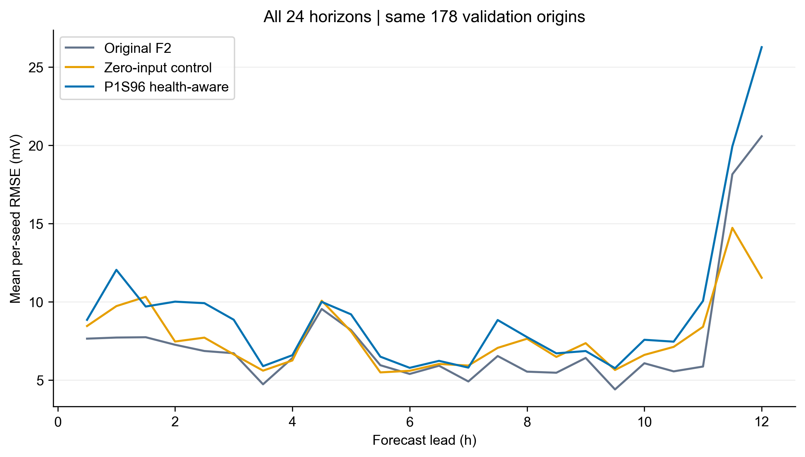
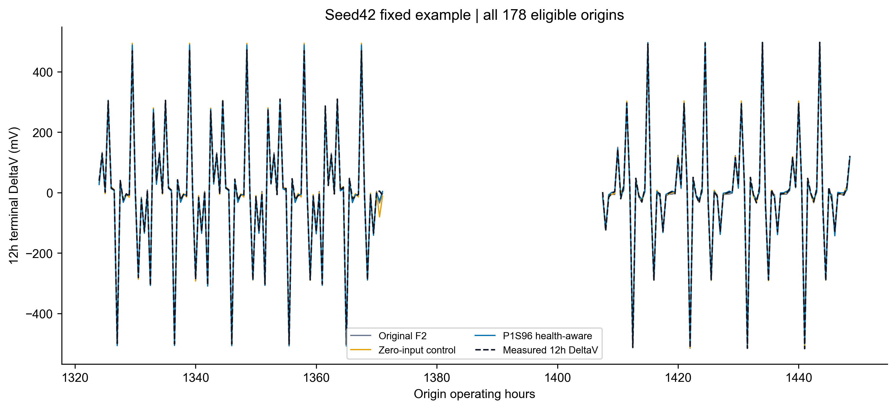
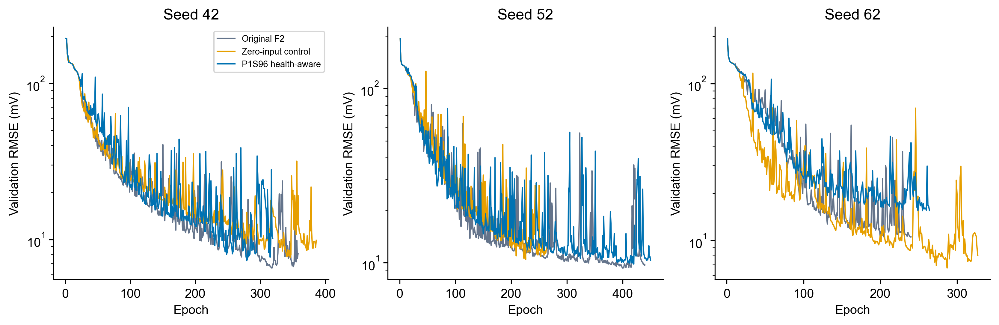

# 九组正式训练结果

九组全部完成，A/B/C各Seed42/52/62均为从头训练，没有失败组反复重启或替换成绩。每组870个Train、178个Validation起点，4272个预测查询和224个去重目标时间行。

| model | Seed42_RMSE_mV | Seed52_RMSE_mV | Seed62_RMSE_mV | mean_RMSE_mV | sample_SD_mV |
| --- | --- | --- | --- | --- | --- |
| F2_MATCHED | 6.557868 | 9.327468 | 10.319583 | 8.734973 | 1.949593 |
| F2_CAPACITY_CONTROL | 7.664547 | 10.440401 | 6.676996 | 8.260648 | 1.951232 |
| F2_P1S96_HEALTH_AWARE | 7.313528 | 9.820168 | 14.972941 | 10.702212 | 3.905145 |

完整逐运行指标：

| model | seed | RMSE_mV | MAE_mV | endpoint_12h_RMSE_mV | target_time_equal_RMSE_mV | P95_abs_error_mV | P99_abs_error_mV | max_abs_error_mV | best_epoch | stop_epoch | training_seconds | peak_GPU_bytes |
| --- | --- | --- | --- | --- | --- | --- | --- | --- | --- | --- | --- | --- |
| F2_MATCHED | 42 | 6.557868 | 4.603758 | 6.886512 | 6.932655 | 12.316056 | 21.955386 | 60.577363 | 318 | 358 | 1991.770851 | 100754432 |
| F2_CAPACITY_CONTROL | 42 | 7.664547 | 5.266208 | 9.353851 | 8.844346 | 14.186702 | 30.285369 | 85.565703 | 346 | 386 | 2141.540497 | 100754944 |
| F2_P1S96_HEALTH_AWARE | 42 | 7.313528 | 5.220071 | 7.628693 | 7.691287 | 14.564321 | 23.908931 | 64.331263 | 279 | 319 | 1768.968280 | 100754944 |
| F2_MATCHED | 52 | 9.327468 | 3.929389 | 31.233999 | 28.224624 | 9.505357 | 15.191196 | 304.180293 | 400 | 440 | 2500.399154 | 100754432 |
| F2_CAPACITY_CONTROL | 52 | 10.440401 | 6.614934 | 15.963217 | 15.857393 | 18.114756 | 29.935100 | 178.417742 | 226 | 266 | 1510.163127 | 100754944 |
| F2_P1S96_HEALTH_AWARE | 52 | 9.820168 | 4.236290 | 31.541505 | 28.458732 | 11.139230 | 18.548291 | 303.344370 | 420 | 450 | 2633.988308 | 100754944 |
| F2_MATCHED | 62 | 10.319583 | 5.825877 | 23.585606 | 26.006416 | 16.188865 | 25.750806 | 309.605466 | 200 | 240 | 1461.199775 | 100754432 |
| F2_CAPACITY_CONTROL | 62 | 6.676996 | 3.901138 | 9.269558 | 14.162689 | 10.770450 | 16.556577 | 257.082786 | 287 | 327 | 1366.846953 | 100754944 |
| F2_P1S96_HEALTH_AWARE | 62 | 14.972941 | 7.841687 | 39.607370 | 31.871401 | 19.423633 | 43.011318 | 318.525435 | 224 | 264 | 1428.726454 | 100754944 |

三Seed平均与样本SD(ddof=1)：

| model | RMSE_mV | MAE_mV | endpoint_12h_RMSE_mV | target_time_equal_RMSE_mV | P95_abs_error_mV | P99_abs_error_mV | max_abs_error_mV | RMSE_sample_SD_mV |
| --- | --- | --- | --- | --- | --- | --- | --- | --- |
| F2_MATCHED | 8.734973 | 4.786341 | 20.568706 | 20.387898 | 12.670093 | 20.965796 | 224.787707 | 1.949593 |
| F2_CAPACITY_CONTROL | 8.260648 | 5.260760 | 11.528875 | 12.954809 | 14.357303 | 25.592349 | 173.688744 | 1.951232 |
| F2_P1S96_HEALTH_AWARE | 10.702212 | 5.766016 | 26.259189 | 22.673807 | 15.042394 | 28.489513 | 228.733690 | 3.905145 |

所有本轮误差均为真实动态DeltaV电压预测mV，不是P1S mV-equivalent，也不是SOH/RUL误差。主指标按178×24个预测查询等权；三Seed均值为三次独立运行RMSE的算术平均。重叠查询与去重时间行不意味着统计独立。

每组逐点CSV、24步长CSV、目标时刻SSE均值CSV、门控权重CSV、逐epoch日志及best checkpoint都在outputs。checkpoint保存协议SHA、输入fingerprint、初始模型身份、最佳epoch与固定Validation预测；正式worker重载同设备预测逐点一致。独立核验不使用新的训练。

