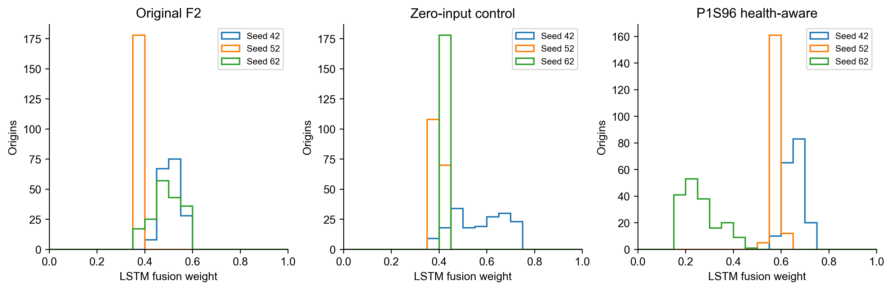

# 消融对照与独立增益

最终判断：`HEALTH_CONTEXT_NO_CLEAR_GAIN`。健康上下文未超过两个正式对照，不支持将其升级为有效创新。

相对原F2_MATCHED的三Seed平均RMSE改善-22.5214%；相对同参数零输入对照改善-29.5566%。正数是改善，负数是恶化。配对Seed同时胜过两个对照：0/3。预设要求相对两对照均至少5%，至少2/3配对Seed同时获益，不因结果修改。

| seed | A_RMSE_mV | B_RMSE_mV | C_RMSE_mV | C_vs_A_RMSE_improvement_percent | C_vs_B_RMSE_improvement_percent | C_beats_both_RMSE |
| --- | --- | --- | --- | --- | --- | --- |
| 42 | 6.557868 | 7.664547 | 7.313528 | -11.522952 | 4.579781 | False |
| 52 | 9.327468 | 10.440401 | 9.820168 | -5.282251 | 5.940701 | False |
| 62 | 10.319583 | 6.676996 | 14.972941 | -45.092492 | -124.246675 | False |

12h末端逐Seed完整比较：

| seed | A_endpoint_12h_RMSE_mV | B_endpoint_12h_RMSE_mV | C_endpoint_12h_RMSE_mV | C_vs_A_endpoint_improvement_percent | C_vs_B_endpoint_improvement_percent |
| --- | --- | --- | --- | --- | --- |
| 42 | 6.886512 | 9.353851 | 7.628693 | -10.777317 | 18.443288 |
| 52 | 31.233999 | 15.963217 | 31.541505 | -0.984523 | -97.588654 |
| 62 | 23.585606 | 9.269558 | 39.607370 | -67.930264 | -327.284354 |

末端评价：fail。12h末端三Seed均值由原F2的20.568706mV升至26.259189mV，恶化27.67%；相对零输入对照11.528875mV恶化127.77%。健康模型三个Seed的末端误差均高于原F2，Seed62由23.585606升至39.607370mV，存在明显恶化。目标时刻等权误差、P95/P99及最大误差均完整公开，不以个别Seed优于参数对照替代失败的主指标。

目标时刻等权误差为每个target row先对其所有查询取误差平方均值，再跨224个目标行平均并开方；不是先集成预测，也没有根据模型误差移除任何目标。各Seed的TTE、P95/P99/最大误差原样公开：

| model | seed | target_time_equal_RMSE_mV | P95_abs_error_mV | P99_abs_error_mV | max_abs_error_mV |
| --- | --- | --- | --- | --- | --- |
| F2_MATCHED | 42 | 6.932655 | 12.316056 | 21.955386 | 60.577363 |
| F2_CAPACITY_CONTROL | 42 | 8.844346 | 14.186702 | 30.285369 | 85.565703 |
| F2_P1S96_HEALTH_AWARE | 42 | 7.691287 | 14.564321 | 23.908931 | 64.331263 |
| F2_MATCHED | 52 | 28.224624 | 9.505357 | 15.191196 | 304.180293 |
| F2_CAPACITY_CONTROL | 52 | 15.857393 | 18.114756 | 29.935100 | 178.417742 |
| F2_P1S96_HEALTH_AWARE | 52 | 28.458732 | 11.139230 | 18.548291 | 303.344370 |
| F2_MATCHED | 62 | 26.006416 | 16.188865 | 25.750806 | 309.605466 |
| F2_CAPACITY_CONTROL | 62 | 14.162689 | 10.770450 | 16.556577 | 257.082786 |
| F2_P1S96_HEALTH_AWARE | 62 | 31.871401 | 19.423633 | 43.011318 | 318.525435 |

本轮实际表现：健康模型相对原F2的三个Seed均退步；相对参数对照虽然Seed42/52分别改善约4.58%/5.94%，Seed62却恶化约124.25%，三Seed平均仍更差。参数对照相对原F2均值低约5.43%，但只在Seed62优于原F2，不能归因于真实健康信息或稳定的容量收益。健康组RMSE样本SD为3.905145mV，约为两对照的两倍。

B/C具有相同参数数目及初始化，B新增健康输入固定为零，只有C有真实健康上下文。因此C相对B的配对差异是本轮识别健康信息价值的主要对照。B比A的变化不可直接归因于新增健康信息：B没有健康输入，且新增列没有数据梯度；不同形状的CUDA数值路径及正常训练非严格确定性可能带来训练差异。

原Phase H全量Validation的F2三SeedRMSE为6.265169/7.034632/8.436399，平均7.245400mV，只作历史附录；1380/205原窗口与本轮870/178不同，禁止混合排名或计算跨阶段改善。本轮不会修复或覆盖P2/P3工况门控独立稳定收益未获支持的结论。

